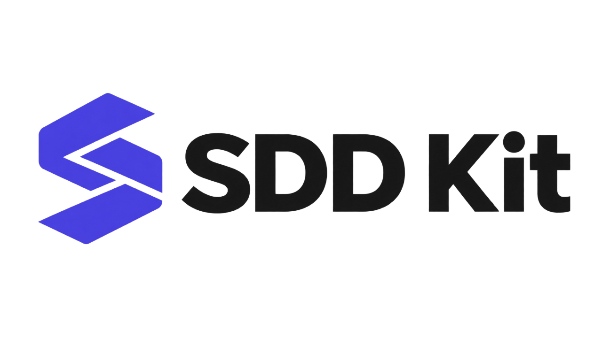

# SDD Kit

<p align="center">
  
</p>

Spec-driven development for **Claude Code and Codex**. Describe the work, agree on what done means, and run a fixed pipeline with tests, review and acceptance evidence. Both hosts use the same workflows, skills, specialist roles, templates and stack definitions.

**Start here:** [Choose your installation](docs/reference/installation.md) · [First session](docs/reference/getting-started.md) · [Compare the hosts](docs/hosts/compare.md) · [Open the interactive guide](#interactive-guide)

## Choose your agent

| | Claude Code | Codex |
| --- | --- | --- |
| Recommended installation | Marketplace plugin; select core and add-ons | Native plugin built from this checkout |
| Alternative | File copy into project or user `.claude/` | No file-copy installer |
| Start SDD | `/sdd-kit:sdd` (plugin); `/sdd` (file copy) | `$sdd` |
| Project instructions | `CLAUDE.md` importing shared `AGENTS.md` | `AGENTS.md` |
| Execution | Claude workflows and subagents | Local MCP bridge and native Codex subagents |
| Full instructions | [Claude Code](docs/hosts/claude.md) | [Codex](docs/hosts/codex.md) |

Installation, host commands, hook trust, model selection and interrupted-run recovery differ. A slash command in a Claude example is not automatically a Codex command. See the [command conventions](docs/hosts/compare.md#commands).

## Install for Claude Code

Inside Claude Code, add the original release marketplace and install the stack-neutral core:

```text
/plugin marketplace add stasmarkov/sdd-kit
/plugin install sdd-kit@sdd-kit
```

For a Laravel API and Next.js frontend, install the preset instead:

```text
/plugin install sdd-kit-laravel-nextjs@sdd-kit
```

Start a fresh session in your application project. Run `/sdd-kit:framework-doctor`, then `/sdd-kit:sdd <task>`. The preset includes core, Laravel, Next.js and development-environment add-ons. [Installation, updates and file-copy mode](docs/hosts/claude.md).

## Install for Codex

Use **this host-enabled checkout**. The original upstream `v3.1.0` tag predates the Codex adapter; pin a reviewed revision of this fork containing `adapters/codex/` instead. In a terminal at the kit repository root, with Node 20+, npm, Git, bash, jq and a Codex CLI exposing `codex plugin add`:

```sh
npm ci --ignore-scripts
node cli/sdd-kit.mjs install --host codex --dry-run
node cli/sdd-kit.mjs install --host codex
```

This builds a local marketplace in `dist/codex` and installs `sdd-kit@sdd-kit`. Keep the checkout for updates. Open a fresh Codex session in your **application** project, review the hook definitions with `/hooks`, then invoke `$framework-doctor` and `$sdd <task>`.

All first-party skill add-ons are bundled. Installing does not approve hooks or custom stack commands. [Full Codex instructions, updates and recovery](docs/hosts/codex.md).

## Your first task

1. Check the installation with `framework-doctor` using your host's syntax above.
2. Put project facts, exact test commands and constraints in `AGENTS.md`. Claude imports it from `CLAUDE.md`. See [project context](docs/reference/getting-started.md#project-context).
3. Use `write-docs --type=all` for an existing application, or `product-brief` for a new product.
4. Start `sdd` with a ticket or description. Review and approve a feature's spec before implementation.
5. Read the final evidence and run manual acceptance steps. Missing tools and unrun browser checks remain visible gaps.

Specs and progress live in `.ai/specs/`, so teammates can share the definition of done across hosts. Changing agents does not transfer active workers or workflow execution state.

## Stacks and add-ons

The core is stack-neutral. Manifests supply stack detection, gate commands and specialist roles. Laravel API + Next.js is the primary worked path; Drupal and iOS remain early add-ons.

| Package | Contents | Claude Code | Codex |
| --- | --- | --- | --- |
| `sdd-kit` | SDD routing, workflows, core skills, roles and guards | Install core | Included |
| `sdd-kit-laravel-nextjs` | Core + Laravel + Next.js + devenv dependency preset | Optional preset | No separate preset needed |
| `sdd-kit-laravel` | Laravel, Pest, Passport, DTOs, migrations, contract-sync | Optional add-on | Skills and resources bundled |
| `sdd-kit-nextjs` | Next.js, TypeScript, Tailwind, frontend tests | Optional add-on | Skills and resources bundled |
| `sdd-kit-devenv` | Docker and DDEV guidance | Optional add-on | Skills bundled |
| `sdd-kit-ops` | Deploy, rollback, flags, health and incidents | Optional add-on | Skills and roles bundled |
| `sdd-kit-design` | UI design skill and advisor | Optional add-on | Skill and role bundled |
| `sdd-kit-drupal` | Drupal 11 skill and scaffolding | Optional add-on | Skill and resources bundled |
| `sdd-kit-ios` | Swift, SwiftUI and testing | Optional add-on | Skills and role bundled |

Bundling a skill does not install its framework, services or external tools. Custom stacks require explicit approval of their commands and manifest hash. See [stack manifests](docs/reference/stack-manifest.md) and [third-party integrations](docs/reference/third-party.md).

## Interactive guide

From this checkout, open the guide in your browser:

```sh
node cli/sdd-kit.mjs guide
```

The header switches between **Claude Code**, **Codex** and **Compare both**, with installation steps and copyable commands for the selected host. The command opens this checkout's `docs/index.html`; GitHub's file viewer shows that HTML as source. You can also open the file directly in a browser. See the [documentation structure](docs/documentation-structure.md) for how shared and host-specific content is organized.

To rebuild after changing Markdown, run `npm run docs:build`, then `npm run docs:check`. Commit the sources and generated pages together; see [maintenance](docs/maintaining-docs.md).

## Tools without an agent session

The spec board reads `.ai/specs` from your current application directory:

```sh
node /path/to/sdd-kit/cli/sdd-kit.mjs spec-board --serve
node /path/to/sdd-kit/cli/sdd-kit.mjs spec-board --out /tmp/spec-board.html
```

The original released CLI is available via GitHub through npx; the package is not published to npm. With npm 11 use `npx github:stasmarkov/sdd-kit spec-board --serve`; with npm 12 add `--allow-git=root`. These original-release commands do not install the fork's Codex adapter.

## Develop and verify the kit

```sh
npm ci --ignore-scripts
npm test
node cli/sdd-kit.mjs build --host all
```

Edit shared behavior under `plugins/` and `share/`; host API differences belong under `adapters/`. `dist/` is generated output. [Architecture and contribution boundaries](docs/architecture.md) explain ownership. [Validation evidence](docs/validation.md) records what was exercised and what remains unverified.

This checkout extends the public 3.1.0 distribution. The original author generates that distribution from a separate source repository; this fork does not change that release pipeline. The upstream release tag and the fork's current revision are different delivery points.

## Further reading

- [Shared first-session guide](docs/reference/getting-started.md)
- [Worked example: Hireboard](docs/examples/job-board/README.md)
- [Skills](docs/reference/skills.md), [agents](docs/reference/agents.md) and [specification format](docs/reference/specification-system.md)
- [Team rollout](docs/reference/team-marketplace.md)
- [Original release history](CHANGELOG.md)

MIT. See [LICENSE](LICENSE).
